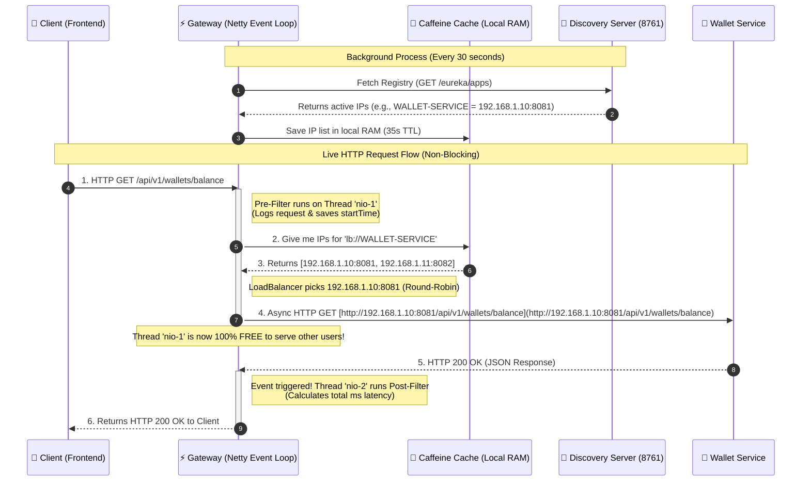

# API Gateway: Architecture, Reactive Engine & Caching

This document explains everything about how the **API Gateway** works in TradeSphere: why we need it, why it uses **Netty** instead of **Tomcat**, how **Client-Side Load Balancing** works with **Caffeine Cache**, and how we solved the Windows DNS/Hostname error.

---

## 1. Why Do We Need an API Gateway?

In a microservices architecture, our backend is split into many small applications (`wallet-service`, `trading-service`, `notification-service`). 
Moreover, in production, these services run on **dynamic IP addresses and random ports (`server.port: 0`)** so we can easily run multiple copies (instances) of them.

If the Frontend (React, iOS, or Android app) tries to call these microservices directly, we face three huge problems:
1. **Dynamic IP Problem:** The Frontend cannot know which IP address or port `wallet-service` is running on today, because containers restart and change their IPs all the time.
2. **Security Nightmare:** If all microservices are open to the public internet, hackers can attack them directly. Also, we would have to write the exact same JWT token validation code inside 10 different microservices.
3. **CORS & SSL Duplication:** We would need to configure HTTPS certificates and CORS rules in every single microservice separately.

### The Solution: Single Entry Point (Main Door)
The API Gateway acts as a **Reverse Proxy (Main Door)** running on a fixed port (`8080`). 
* Outside users (Frontend) **only** know `http://localhost:8080`.
* All other microservices are hidden inside a private network.
* When a request hits the Gateway, the Gateway checks security, looks up the microservice's current IP address from Eureka, and forwards the request.

---

## 2. Under the Hood: Reactive Netty vs. Classic Tomcat

In `infrastructure/api-gateway/pom.xml`, there is a very strict rule:
* We use `spring-cloud-starter-gateway-server-webflux` (which runs on **Netty**).
* We **MUST NOT** add `spring-boot-starter-web` (which runs on **Tomcat**). If both are in `pom.xml`, Spring Boot will fail to start!

Why does the API Gateway use Netty instead of Tomcat? Let's use a simple **Restaurant Analogy** where the Gateway is the restaurant, and **Threads** are the **Waiters**:

### 🔴 How Classic Tomcat Works (Blocking / One Waiter per Request)
Our normal microservices (`wallet-service`, `trading-service`) use Tomcat.
* Tomcat has a fixed pool of waiters (by default, **200 Threads**).
* **Step 1:** Customer #1 comes in and orders food (sends an HTTP request).
* **Step 2:** Waiter #1 takes the order to the kitchen (`wallet-service` database).
* **Step 3 (The Problem):** If the database is slow and takes **3 seconds** to answer, Waiter #1 stands at the kitchen door doing **nothing** for 3 full seconds! He is **blocked** (waiting for I/O).
* **The Crash (Thread Pool Exhaustion):** Imagine 200 users call a slow service at the same time. All 200 waiters are now standing at the kitchen door waiting. When User #201 arrives, there are **zero waiters left** at the front door! User #201 is rejected or stuck waiting, even if they wanted to call a fast service.

### 🟢 How Reactive Netty Works (Non-Blocking Event Loop)
Because *all* traffic passes through the API Gateway, it cannot afford to have blocked threads. That is why it uses **Netty (WebFlux)**.
* Netty has a very small number of super-fast waiters (called **Event Loop Threads**, named `reactor-http-nio-1`, `nio-2`, etc.). Usually, there is only **1 thread per CPU core** (e.g., 4 or 8 threads total).
* **Step 1:** Customer #1 sends a request to the Gateway.
* **Step 2:** Waiter #1 (`reactor-http-nio-1`) checks the request in 1 millisecond, sends it over the network to `wallet-service`, and **immediately walks away!** He does **NOT** wait for `wallet-service` to answer.
* **Step 3:** While `wallet-service` is working for 3 seconds, Waiter #1 goes back to the front door and takes requests from Customer #2, Customer #3, and Customer #1000!
* **Step 4:** When `wallet-service` finally sends the response back 3 seconds later, the Operating System (Linux `epoll` / Windows `IOCP`) rings a bell (an **Event / Callback**). Whichever waiter is free at that moment picks up the response and gives it back to Customer #1.



---

## 3. Historical Note: Can API Gateway Use Tomcat Today? (Spring Cloud 2025+)

When we first ran the Gateway, we saw two deprecation warnings in the console:
1. `spring-cloud-starter-gateway is deprecated -> use spring-cloud-starter-gateway-server-webflux`
2. `spring.cloud.gateway.routes -> use spring.cloud.gateway.server.webflux.routes`

**Why did Spring change this?**
In the past, Tomcat was too slow for an API Gateway because of the 200-thread limit. However, **Java 21 introduced Virtual Threads (Project Loom)**, which allows Tomcat to create millions of lightweight virtual threads that do not block the CPU.
Because of this, Spring Cloud `2025.0+` now offers **two types of API Gateway**:
1. **`spring-cloud-starter-gateway-server-webflux` (Netty):** What we use. Maximum performance, lowest memory usage, reactive programming (`Mono`/`Flux`).
2. **`spring-cloud-starter-gateway-server-mvc` (Tomcat + Virtual Threads):** Newer alternative for teams that don't want to write reactive code.

To make it clear which engine you are using, Spring now requires `server.webflux` in both the dependency name and the YAML configuration.

---

## 4. Client-Side Load Balancing & Why We Use Caffeine Cache

### Where Does the Load Balancer Live?
A very common misunderstanding is thinking that **Eureka** balances the load. **Eureka does NOT do load balancing!** Eureka is just a phonebook.
The Load Balancer (**Spring Cloud LoadBalancer**) lives **inside the API Gateway itself** (and inside any microservice that calls another microservice). This is called **Client-Side Load Balancing**.

When the Gateway sees `uri: lb://WALLET-SERVICE`:
1. The Gateway asks its internal LoadBalancer: *"Give me an IP for WALLET-SERVICE."*
2. If there are 2 instances running (`192.168.1.10:8081` and `192.168.1.10:8082`), the LoadBalancer uses the **Round-Robin** algorithm: Request 1 goes to `8081`, Request 2 goes to `8082`, Request 3 goes to `8081`, and so on.

### Why Do We Need a Cache in the LoadBalancer?
If the Gateway gets 5,000 requests per second and calls Eureka (`localhost:8761`) 5,000 times per second to ask for the IP address, Eureka will crash and every request will be slow.
Instead, the Gateway fetches the IP list from Eureka once and caches it in its own RAM for **35 seconds (TTL)**.

### Why Did We Add `caffeine` to `pom.xml`? (Default Cache vs. Caffeine)
If we don't add `caffeine`, Spring uses a simple default cache built on Java's `ConcurrentHashMap`. 
You might ask: *"Isn't `ConcurrentHashMap` great for multithreading?"*
* **For Reading:** Yes, reading from `ConcurrentHashMap` is lock-free and super fast.
* **For Updating (The Trap):** When the 35-second cache expires, the key `WALLET-SERVICE` becomes empty. Imagine 500 user requests arrive at that exact millisecond!
  * All 500 threads see the cache is empty (**Cache Miss**) and try to write the new IP list into the **exact same key (`WALLET-SERVICE`)** at the same time.
  * When multiple threads write to the **same key** in `ConcurrentHashMap`, Java puts a `synchronized` lock on that key!
  * 1 thread writes, and **499 threads are blocked waiting** (**Lock Contention**).
  * Remember: Netty only has 4 or 8 threads! If 4 threads get locked waiting on the cache, half of our entire API Gateway freezes!

### How Caffeine Cache Solves This
By adding `com.github.ben-manes.caffeine:caffeine` to `pom.xml` (no version or scope needed, because Spring Boot's parent BOM manages the exact version automatically), Spring switches to **Caffeine Cache**:
1. **Non-Blocking Ring Buffers:** Caffeine does not lock threads during writes/updates. It puts update tasks into an asynchronous buffer and immediately frees the Netty thread.
2. **Smart Refresh (No Stampede):** When the 35-second timer expires and 500 requests arrive, Caffeine allows **only 1 thread** to update the cache in the background, while immediately giving the slightly old IP list to the other 499 requests so zero threads wait!
3. **W-TinyLFU Algorithm:** Keeps the most frequently used services in memory with ~99% accuracy.

---

## 5. Real-World Troubleshooting: The Windows Hostname & DNS Trap (`NXDOMAIN`)

When we first tested routing through the Gateway (`http://localhost:8080/config/application/default`), we got this crash:

```text
java.net.UnknownHostException: Failed to resolve 'DESKTOP-GITVR7E.mshome.net'
Caused by: io.netty.resolver.dns.DnsErrorCauseException: Query failed with NXDOMAIN
```

### What Do These Terms Mean? (Simple Explanation)
* **OS Hostname:** The name of your computer (e.g., `DESKTOP-GITVR7E`).
* **WSL / Hyper-V & `.mshome.net`:** When Windows has virtual network features enabled (like Docker or WSL), Windows creates a fake internal domain name and changes your computer's full nickname to `DESKTOP-GITVR7E.mshome.net`.
* **DNS (Domain Name System):** The internet's phonebook that translates text names (like `google.com`) into real IP numbers (like `142.250.185.46`).
* **Real-World Analogy of the Crash:**
  1. Your friend's real home address (IP) is `192.168.1.5`, but his street nickname is `DESKTOP-GITVR7E.mshome.net`.
  2. By default, when `config-server` registered with Eureka, it did **not** give its real IP address. It told Eureka: *"My address is `DESKTOP-GITVR7E.mshome.net:8888`."*
  3. When the API Gateway asked Eureka where `config-server` is, Eureka gave it that nickname.
  4. Netty inside the Gateway uses its own fast **Async DNS Resolver**. It asked your Wi-Fi router's DNS server: *"What is the IP address for `DESKTOP-GITVR7E.mshome.net`?"*
  5. Your router's DNS server said: *"That is a fake Windows nickname, not a real website! (`NXDOMAIN` = Non-Existent Domain)"* and the connection failed.

### The Permanent Fix (`prefer-ip-address: true`)
To fix this forever, we added this setting to `config-server`'s local `application.yml` AND to the global `shared-configs/application.yml`:

```yaml
eureka:
  instance:
    prefer-ip-address: true
```
**What this does:** It tells every microservice: *"Never send your computer's hostname/nickname to Eureka! Always send your real IP number (e.g., `192.168.1.5` or `127.0.0.1`)."* 
Because the Gateway now receives a direct IP number from Eureka, Netty doesn't need to ask any DNS server at all—it connects directly to the IP!