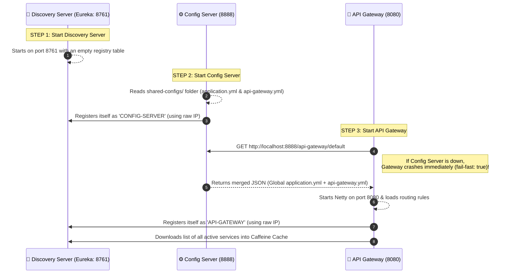

# Routing Rules, Predicates, and Filters Guide

This guide explains every line inside `shared-configs/api-gateway.yml` and `api-gateway/src/main/resources/application.yaml`. It covers how routes work, why we see duplicate routes in Actuator, when to use `StripPrefix`, and how startup configuration works.

---

## 1. Startup Sequence: How the System Boots Up

In TradeSphere, microservices cannot start in random order because they depend on each other. Here is the exact step-by-step startup flow:



### Why We Removed `optional:` and Added `fail-fast: true`
In `infrastructure/api-gateway/src/main/resources/application.yaml`, we wrote:
```yaml
spring:
  application:
    name: api-gateway
  config:
    import: "configserver:http://localhost:8888"
  cloud:
    config:
      fail-fast: true
```
* **What happens if you write `optional:configserver:http://localhost:8888`?**
  The word `optional:` tells Spring Boot: *"If Config Server is not running on port 8888, ignore the error and start anyway."*
* **Why is `optional:` bad for the API Gateway?**
  Because the Gateway's local `application.yaml` is almost empty! All of its routes (`/api/v1/wallets/**`, etc.), port `8080`, and Eureka settings live inside the Config Server (`shared-configs/api-gateway.yml`). If the Gateway starts without the Config Server, it becomes a useless empty shell with zero routes.
* **Why `fail-fast: true` is Best Practice:**
  If you forget to start `config-server` first, `fail-fast: true` forces the API Gateway to stop immediately during boot with a clear error (`ConfigClientFailFastException`), so you immediately know what went wrong.

---

## 2. Anatomy of a Route in `api-gateway.yml`

Every route under `spring.cloud.gateway.server.webflux.routes` has 4 parts:

1. **`id`**: A unique name for the route (e.g., `wallet-service-route`).
2. **`uri`**: Where to send the traffic.
   * `lb://WALLET-SERVICE`: Uses the internal LoadBalancer to get the dynamic IP and port of `WALLET-SERVICE` from Eureka/Caffeine Cache.
   * `http://example.com`: Sends traffic to a fixed external website without using Eureka.
3. **`predicates`**: The **"IF" conditions**. A request only enters this route if all predicates are `true`.
   * Most common: `Path=/api/v1/wallets/**` (Checks the URL path).
   * Other examples you can use when needed: `Method=GET,POST`, `Header=X-Request-Id, \d+`, `Host=**.tradesphere.com`, or `After=2026-01-01T00:00:00Z`.
4. **`filters`**: Modifications applied to the request *before* sending it to the microservice, or to the response *after* receiving it.

---

## 3. Automatic Discovery Locator vs. Manual Routes

When we open `http://localhost:8080/actuator/gateway/routes`, we see **two routes** pointing to `lb://CONFIG-SERVER`:
1. `route_id: "ReactiveCompositeDiscoveryClient_CONFIG-SERVER"` (Matches `/config-server/**`)
2. `route_id: "config-server-route"` (Matches `/config/**`)

### Why Are There Two Routes for Config Server?
Because in `shared-configs/api-gateway.yml`, we enabled **both** Automatic Discovery Locator and Manual Routes:

```yaml
spring:
  cloud:
    gateway:
      server:
        webflux:
          discovery:
            locator:
              enabled: true
              lower-case-service-id: true
```

* **Route #1 comes from `discovery.locator.enabled: true`:**
  When this is `true`, the Gateway looks at every service registered in Eureka (`CONFIG-SERVER`, `API-GATEWAY`, etc.) and **automatically** creates a route using the service's name in lowercase:
  * `http://localhost:8080/config-server/application/default`
  * Behind the scenes, it automatically adds a `RewritePath` filter to remove `/config-server` before forwarding the request.
* **Route #2 comes from our manual `routes:` list:**
  We manually created `config-server-route` with `Path=/config/**` and `StripPrefix=1`, which lets us call:
  * `http://localhost:8080/config/application/default`

### Architectural Decision: When to Use Which?

| Environment | `discovery.locator.enabled` | Why? |
| :--- | :--- | :--- |
| **Local Development** | `true` | Great for fast testing! When you create a new microservice, it is automatically reachable through the Gateway without editing YAML files. |
| **Production** | **`false` (Mandatory!)** | Leaving it `true` in production is a huge **security risk**! It exposes internal-only services (like `config-server` or background settlement workers) to the public internet. In production, set it to `false` and only expose the exact paths listed under manual `routes:`. |

---

## 4. Path Manipulation: `StripPrefix` vs. No Filter vs. `RewritePath`

One of the most common mistakes in API Gateway configuration is misusing `StripPrefix`. Let's compare the three approaches:

```mermaid
flowchart TD
  subgraph Case1 ["Case 1: With StripPrefix=1"]
    A1["Client calls:<br>GET /config/application/default"] --> B1["Filter: StripPrefix=1<br>(Cuts 1st part: '/config')"]
    B1 --> C1["Config Server receives:<br>GET /application/default ✅"]
  end

  subgraph Case2 ["Case 2: No StripPrefix (Direct Match)"]
    A2["Client calls:<br>GET /api/v1/wallets/balance"] --> B2["No Path Filter Needed!"]
    B2 --> C2["Wallet Service receives:<br>GET /api/v1/wallets/balance ✅"]
  end

  subgraph Case3 ["Case 3: With RewritePath (Regex)"]
    A3["Client calls:<br>GET /v1/pay/500"] --> B3["Filter: RewritePath<br>/v1/pay/(?&lt;id&gt;.*) -> /internal/payments/${id}"]
    B3 --> C3["Payment Service receives:<br>GET /internal/payments/500 ✅"]
  end
```



### Rule of Thumb:
1. **Use `StripPrefix=1`** when you add a "nickname" prefix in the Gateway (like `/config/**`) that does **not** exist inside the target microservice's `@RequestMapping`. (`StripPrefix=2` would cut the first 2 segments, e.g., `/a/b/c` -> `/c`).
2. **Use NO Filter** when your microservice's `@RestController` already has `@RequestMapping("/api/v1/wallets")` and the Gateway predicate is also `Path=/api/v1/wallets/**`. Because the paths are identical, adding `StripPrefix=1` here would cut off `/api` and break your call with a `404 Not Found`!
3. **Use `RewritePath`** when the public URL and internal URL have completely different structures (for example, hiding ugly legacy URLs behind clean public URLs).