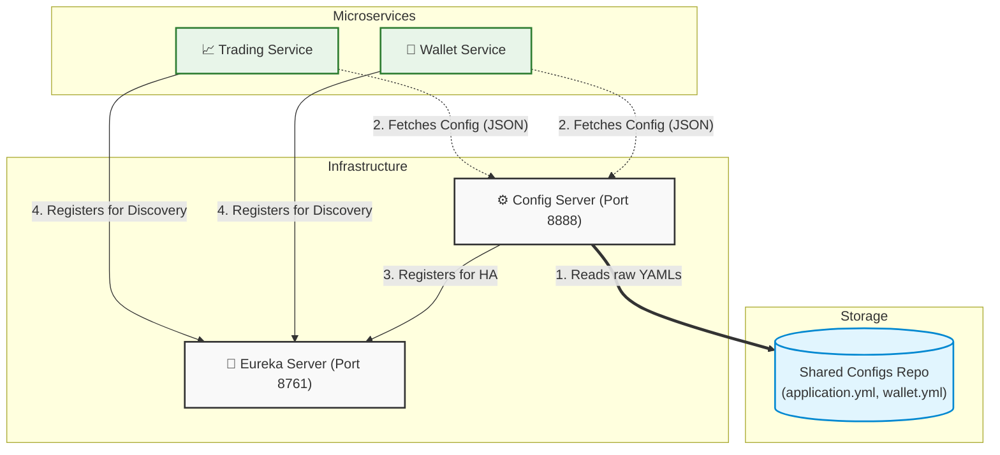
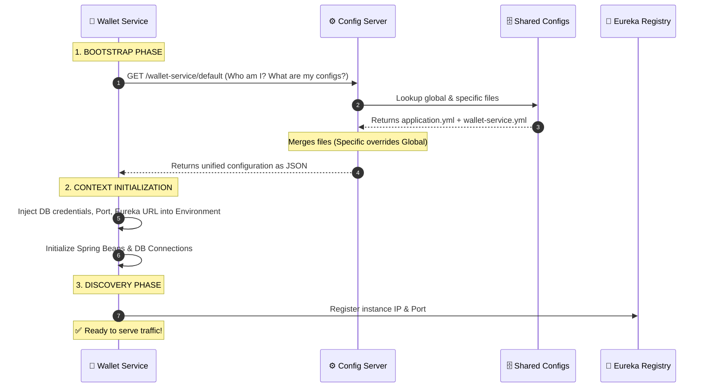

# Centralized Configuration Server: Architecture & Flow

This document outlines the architectural role, problem-solving capabilities, and process flow of the **Spring Cloud Config Server** within the TradeSphere microservices ecosystem.

---

## 1. The Problem: "Configuration Hell"

In a standard microservice architecture, each service (e.g., Wallet, Trading, Notification) has its own local `application.yml` containing critical data such as database credentials, external API keys, and server ports. As the system grows, this decentralized approach causes severe operational pain points known as **Configuration Hell**:

* **Maintenance Nightmare:** Changing a shared database password requires editing code in 10 different repositories.
* **Costly Redeployments:** Even a minor typo fix in an email template requires a full CI/CD pipeline run (build, test, deploy) for the affected service.
* **Security Risks:** Sensitive credentials are often hardcoded and leaked into version control.

## 2. The Solution: Externalized Configuration

The **Config Server** extracts all configuration files out of the individual microservices and centralizes them in a single, secure location (a Git repository or a native shared folder). 

Microservices become **stateless regarding their configuration**. When a service boots up, it asks the Config Server for its environment variables over HTTP before doing anything else.

---

## 3. High-Level Architecture

The following diagram illustrates how the Config Server interacts with the rest of the TradeSphere infrastructure.

---

## 4. Microservice Startup Flow (Sequence Diagram)

Because the microservice has no local database passwords or ports, the startup sequence is strictly ordered. Here is the exact HTTP flow when a service (e.g., `wallet-service`) boots up:

---

## 5. Core Concepts to Remember

### 5.1. Global vs. Specific Configurations
* `application.yml`: **The Global Rulebook.** Settings defined here (like Eureka URLs or Kafka brokers) are automatically distributed to *all* microservices. 
* `[service-name].yml`: **The Specific Overrides.** Files named after a specific application (e.g., `wallet-service.yml`) are only sent to that exact service. If there is a conflict, the specific file overrides the global one.

### 5.2. Dynamic Refresh (`@RefreshScope`)
If we change a value in the `shared-configs` repository, we do not need to restart our microservices. By annotating our Spring components with `@RefreshScope`, we can send an empty `POST` request to `http://microservice-ip/actuator/refresh`. The service will instantly reach out to the Config Server, fetch the new data, and update its beans in memory with **zero downtime**.

### 5.3. Why does the Config Server connect to Eureka?
The Config Server is a microservice itself. It connects to the Service Registry for three critical reasons:
1. **Dynamic Discovery:** Other microservices don't need to hardcode `localhost:8888`. They just ask Eureka: *"Where is the CONFIG-SERVER?"*
2. **High Availability (HA):** In production, we run multiple instances of the Config Server. Eureka acts as a load balancer to distribute the configuration requests among them.
3. **Health Monitoring:** We can use the Eureka dashboard to instantly verify if our centralized configuration brain is online or offline.