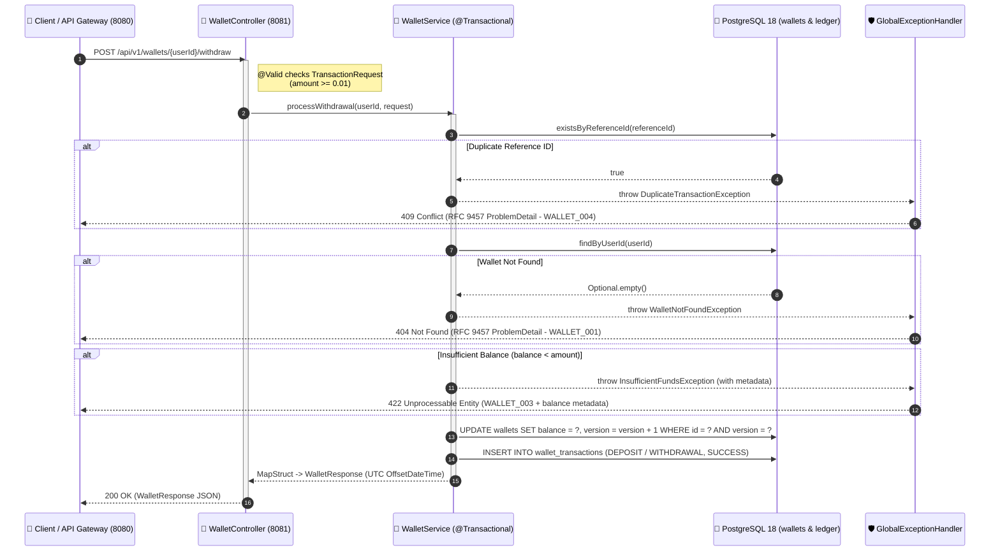

# 💼 TradeSphere - Wallet Service

This module is the core financial microservice of the **TradeSphere** ecosystem. It is responsible for provisioning user wallets, managing fiat/crypto balances, enforcing concurrency invariants, and recording an immutable audit ledger of all financial transactions.

---

## 🏗️ Architecture & Request Flow

The service strictly follows **Clean Architecture** boundaries:
* **Thin Controller Layer:** `WalletController` acts purely as an HTTP adapter and delegates all business rules and DTO conversions to the service layer.
* **Transactional Service Boundary:** `WalletService` encapsulates domain invariants, idempotency verification, and Entity-to-DTO mapping (via **MapStruct**) inside `@Transactional` boundaries to prevent `LazyInitializationException`.
* **Database-per-Service:** Connects to an isolated **PostgreSQL 18** instance (`tradesphere_wallet`) managed exclusively via **Liquibase** YAML migrations (`ddl-auto: validate`).



---

## 🧠 Key Engineering Decisions

### 1. Concurrency Control (Optimistic Locking)
To prevent **Lost Updates** and race conditions when two concurrent requests attempt to modify a user's balance simultaneously, the `Wallet` entity utilizes JPA `@Version` (`bigint`). If a concurrent modification is detected at commit time, Spring throws `OptimisticLockingFailureException`, which `GlobalExceptionHandler` translates into a clean `409 Conflict` (`WALLET_005`) instructing the client to retry.

### 2. Idempotency Protection
Financial operations (`deposit` and `withdraw`) accept an optional `referenceId` (e.g., an external payment gateway webhook ID or order ID). Before mutating any balance, `WalletService` verifies uniqueness via `existsByReferenceId` (backed by a database `UNIQUE` constraint on `wallet_transactions.reference_id`), guaranteeing **At-Most-Once** processing.

### 3. Standardized Error Handling (RFC 9457 `ProblemDetail`)
All domain exceptions extend an immutable `BaseDomainException` bound to a centralized `ErrorCode` catalog. `GlobalExceptionHandler` translates exceptions into `ApiErrorResponse` (extending Spring's RFC 9457 `ProblemDetail`), providing machine-readable error codes (`WALLET_001` – `WALLET_500`), UTC timestamps, dynamic context `metadata`, and sanitized field validation errors (masking sensitive fields like `pin`, `cvv`, `password`).

### 4. Financial Precision & UTC Time Standardization
* **Monetary Values:** Stored as `DECIMAL(19, 4)` in PostgreSQL and processed via immutable `BigDecimal` in Java.
* **Timestamps:** Stored as `timestamptz` (`Instant`) in the database and exposed as UTC `OffsetDateTime` (`2026-11-15T...Z`) via MapStruct.

---

## 🔌 REST API Endpoints

| HTTP Method | Endpoint | Description | Success Status | Error Codes |
| :--- | :--- | :--- | :--- | :--- |
| `POST` | `/api/v1/wallets/{userId}?currency=USD` | Provisions a new active wallet with `0.0000` balance | `201 Created` | `409` (`WALLET_002`) |
| `GET` | `/api/v1/wallets/{userId}` | Retrieves wallet details and current balance | `200 OK` | `404` (`WALLET_001`) |
| `POST` | `/api/v1/wallets/{userId}/deposit` | Credits funds and appends a `DEPOSIT` ledger entry | `200 OK` | `400`, `404`, `409` (`WALLET_004`) |
| `POST` | `/api/v1/wallets/{userId}/withdraw` | Debits funds and appends a `WITHDRAWAL` ledger entry | `200 OK` | `400`, `404`, `409`, `422` (`WALLET_003`) |

---

## 🚀 How to Run & Verify

### 1. Prerequisites (Strict Startup Order)
1. **PostgreSQL 18 Container:**
   ```bash
   docker compose up -d postgres-wallet
   ```
2. **Discovery Server (`infrastructure/discovery-server`)** — Port `8761`
3. **Config Server (`infrastructure/config-server`)** — Port `8888`
4. **API Gateway (`infrastructure/api-gateway`)** — Port `8080` *(Optional for direct calls)*
5. **Wallet Service (`services/wallet-service`)** — Port `8081`

### 2. Verification & Interactive Documentation URLs
* **Swagger UI (Interactive API Docs):** `http://localhost:8081/swagger-ui.html`
* **OpenAPI 3.0 JSON Schema:** `http://localhost:8081/v3/api-docs`
* **Actuator Health Check (DB & Eureka Status):** `http://localhost:8081/actuator/health`
* **Via API Gateway:** `http://localhost:8080/api/v1/wallets/{userId}`

---

## ⚙️ Tech Stack
* **Java 21 & Spring Boot 3.5.16**
* **Spring Cloud (`2025.0.3` - Config Client & Netflix Eureka Client)**
* **Spring Data JPA (Hibernate) & Liquibase (YAML Migrations)**
* **PostgreSQL 18 (`postgres:18-alpine`)**
* **MapStruct `1.6.3` & Lombok**
* **SpringDoc OpenAPI `2.10.0` (Swagger UI)**

---

## 📌 Future Enhancements & Backlog (Wallet Service)

- [ ] **Multi-Currency Wallet Support:** Refactor `wallets` table unique constraint from `(user_id)` to a composite unique constraint `(user_id, currency)` so a single user can hold separate USD, AZN, and EUR wallets (`existsByUserIdAndCurrency`).
- [ ] **Paginated Transaction History Endpoint:** Expose `GET /api/v1/wallets/{userId}/transactions` utilizing `WalletTransactionRepository.findByWalletIdOrderByCreatedAtDesc(UUID, Pageable)` and a dedicated `TransactionResponse` DTO.
- [ ] **Peer-to-Peer (P2P) Wallet Transfer:** Implement atomic balance transfer between two users (`POST /api/v1/wallets/transfer`) with deterministic lock ordering (sorting by Wallet UUID) to prevent database deadlocks.
- [ ] **UUIDv7 Migration:** Evaluate migrating primary key generation from random `UUIDv4` to time-ordered `UUIDv7` to eliminate B-Tree index fragmentation under high write throughput.
- [ ] **Automated Testing Suite:** 
  - Unit testing business rules in `WalletService` using **JUnit 5**, **Mockito** (`@Nested`, `ArgumentCaptor`), and **AssertJ**.
  - End-to-end integration testing of REST endpoints, Liquibase migrations, and `@Version` optimistic locking using **Testcontainers** (`postgres:18-alpine`) and **MockMvc**.